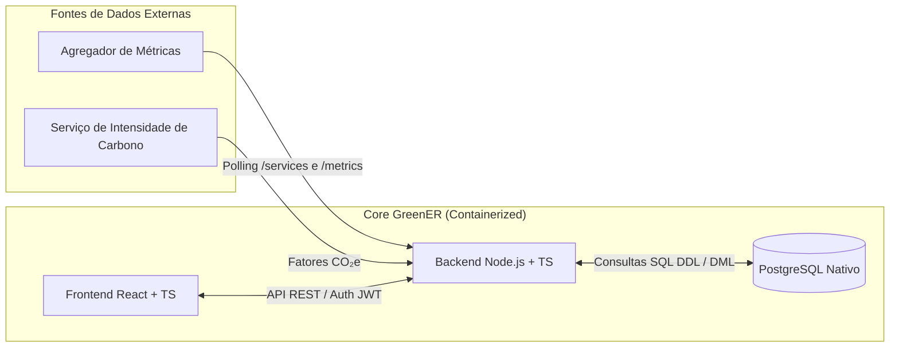
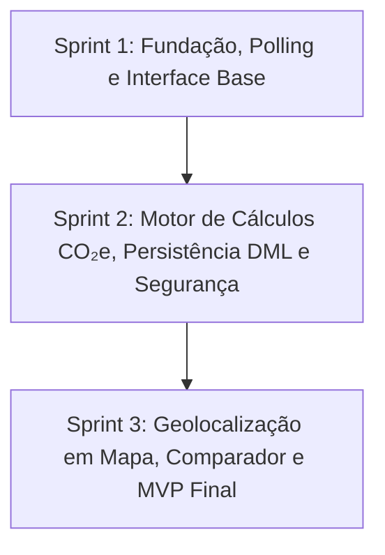

# 🍃 EcoByteMetrics (GreenER)

**EcoByteMetrics** — É uma plataforma web voltada à análise e ao monitoramento do consumo energético e da emissão de CO₂e de softwares.

---

### 💡 Visão do Produto & Valor para o Cliente
O **EcoByteMetrics** resolve a falta de visibilidade sobre o impacto ambiental de arquiteturas em nuvem e microsserviços. A plataforma atua em três pilares fundamentais:
* 🔍 **Descoberta & Monitoramento Ativo:** Conecta-se ao ambiente para listar e monitorar dinamicamente microsserviços ativos, detectando indisponividades, oscilações ou falhas na exportação de dados em tempo real.
* ⚡ **Análise Ambiental (ESG):** Converte a utilização de recursos (CPU, memória, rede) em consumo energético (kWh) e emissões de carbono (CO₂e) correlacionando dados com a localização geográfica e fatores regionais de carbono.
* 📊 **Gestão Operacional & Comparativa:** Oferece dashboards operacionais, rankings de impacto por período, mapeamento geográfico e comparadores de eficiência ambiental entre aplicações.

---

### 🏗️ Arquitetura do Sistema & Mapeamento de Tecnologias



<details>
<summary><b>🛠️ Clique aqui para expandir a Matriz de Diretrizes Técnicas (RP01 a RP07)</b></summary>

<br>

| Camada / Frente | Tecnologia Utilizada | Regra de Engenharia | Restrição Aplicada |
| :--- | :--- | :--- | :--- |
| **Interface Web** | React + TypeScript | Design responsivo para desktop e mobile | **RP01** |
| **API Backend** | Node.js + TypeScript | Arquitetura modular (Controllers, Services, Modules) | **RP02** |
| **Persistência** | PostgreSQL Nativo | Manipulação estrita via DDL e DML (**Proibido uso de ORM**) | **RP03** |
| **Infraestrutura** | Docker / Docker Compose | Orquestração e execução 100% containerizada | **RP04** |
| **Entregável** | MVP Semestral | Solução funcional focada nas entregas do semestre | **RP05** |
| **Segurança** | Autenticação JWT | Proteção da área de configuração via token no backend | **RP06** |
| **Metodologia** | Scrum / Gestão Ágil | Evolução via Sprints, Backlog priorizado e Reviews | **RP07** |

</details>

---

### 🔌 Configuração das APIs Auxiliares

A plataforma consome duas APIs externas para realizar a amostragem de infraestrutura e o cálculo ambiental:

1. **Agregador de Métricas:**
   * **Variável `.env`:** `METRICS_AGGREGATOR_URL=http://agregador-metricas.local:8080`
   * **Endpoints Consumidos:** `GET /services` (descoberta de aplicações) e `GET /metrics/{id_servico}` (amostragem de consumo de hardware).
2. **Serviço de Intensidade de Carbono:**
   * **Variável `.env`:** `CARBON_INTENSITY_URL=http://carbon-intensity.local:8081`
   * **Endpoint Consumido:** `GET /carbon-intensity/{code}` (obtenção de fatores regionais de emissão).

---

### 🗄️ Modelo de Dados Relacional (PostgreSQL Nativo)

Conforme a restrição **RP03**, a persistência é feita exclusivamente em SQL nativo sem ORM:

<details>
<summary><b>🗃️ Clique aqui para expandir os Scripts SQL DDL de Criação de Tabelas</b></summary>

<br>

```sql
create table Users(
	id_user int GENERATED ALWAYS AS IDENTITY PRIMARY KEY,
	name_user varchar(50) not null,
	email_user varchar(50) not null,
	password_user varchar(25)not null,
	token_user varchar(255)not null
);
create table Locations(
	id_location int GENERATED ALWAYS AS IDENTITY PRIMARY KEY,
	name_location varchar(50)not null,
	county_location varchar(50),
	region_location varchar(50),
	city_location varchar(50),
	latitude_location double precision not null,
	logitude_location double precision not null
);

create table Services(
	id_service int GENERATED ALWAYS AS IDENTITY PRIMARY KEY,
	id_location int,
	name_service varchar(50),
	constraint fk_service 
	foreign key (id_location)
	references locations(id_location)
);

create table Metrics (
	id_metric int GENERATED ALWAYS AS IDENTITY PRIMARY KEY,
	id_service int,
	date_houry TIMESTAMP NOT NULL,
	path_metric varchar(50) not null,
	colletion_interval_metric int not null,
	cpu_metric numeric not null,
	ram_metric numeric not null,
	hd_metric numeric not null,
	network_metric numeric not null,
	constraint fk_service
	foreign key (id_service)
	references services(id_service)
);

create table Cabons(
	id_carbon int GENERATED ALWAYS AS IDENTITY PRIMARY KEY,
	id_location int,
	date_houry TIMESTAMP not null,
	intesity_co2e_kwh_carbon int not null,
	renewable_percent_carbon int not null,
	constraint fk_service
	foreign key(id_location)
	references locations(id_location)
);
```

</details>

---


### 📑 Catálogo de Requisitos

<details>
<summary><b>📑 Clique aqui para ver a Tabela de Requisitos Funcionais (RF01 a RF15)</b></summary>

<br>

| ID | Requisito | Descrição Curta |
| :--- | :--- | :--- |
| **RF01** | **Descoberta de Serviços** | Identificar automaticamente os serviços disponíveis no Agregador de Métricas. |
| **RF02** | **Monitoramento Dinâmico** | Reconhecer inclusão, remoção e reaparecimento de serviços em tempo de execução. |
| **RF03** | **Coleta por Serviço** | Consultar o endpoint `/metrics/{id_servico}` periodicamente. |
| **RF04** | **Tratamento de Variações** | Processar variações contínuas nos dados retornados pela API. |
| **RF05** | **Detecção de Indisponibilidade** | Sinalizar quando um serviço não responder às chamadas de coleta. |
| **RF06** | **Ausência de Métricas** | Identificar serviços presentes em `/services` que não exportem métricas. |
| **RF07** | **Cálculo Individual** | Calcular o consumo de energia e emissão de CO₂e de cada aplicação. |
| **RF08** | **Indicadores Agregados** | Consolidação dos totais de consumo, emissões e estado dos serviços. |
| **RF09** | **Dashboard Operacional** | Exibir estado, localização, métricas, energia e emissões por serviço. |
| **RF10** | **Histórico de Coletas** | Armazenar o histórico temporal para auditoria e análises de evolução. |
| **RF11** | **Atualização Contínua** | Atualizar a interface automaticamente sem necessidade de reload na página. |
| **RF12** | **Localização Geográfica** | Apresentar país, região e cidade onde a aplicação está hospedada. |
| **RF13** | **Visualização em Mapa** | Exibir localização dos serviços em um mapa quando coordenadas estiverem disponíveis. |
| **RF14** | **Ranking de Impacto** | Ordenar serviços por maior consumo energético ou emissão de CO₂e em determinado período. |
| **RF15** | **Comparação de Serviços** | Comparar indicadores ambientais entre múltiplos serviços no mesmo intervalo de tempo. |

</details>

<details>
<summary><b>⚡ Clique aqui para ver a Tabela de Requisitos Não Funcionais (RNF01 a RNF05)</b></summary>

<br>

| ID | Requisito | Diretriz de Qualidade |
| :--- | :--- | :--- |
| **RNF01** | **Usabilidade & Responsividade** | Layout responsivo e amigável para navegação em dispositivos móveis e desktop. |
| **RNF02** | **Atualização em Tempo Real** | Intervalos definidos de amostragem com exibição da data/hora da última leitura. |
| **RNF03** | **Desempenho** | Resposta rápida e fluida para o acompanhamento contínuo da infraestrutura. |
| **RNF04** | **Tolerância a Falhas** | Garantir funcionamento contínuo do sistema mesmo com a queda de serviços. |
| **RNF05** | **Documentação Técnica** | Manual completo com arquitetura, modelo de dados, rotas e instruções. |

</details>

---

### 📋 Backlog de Produto & Mapeamento da Sprint 1

O backlog foi organizado para priorizar as entregas essenciais do MVP ao longo do semestre.

#### 📌 Mapeamento de User Stories
| ID | User Story | Requisitos Relacionados | Sprint |
| :--- | :--- | :--- | :--- |
| **US00** | **Setup Infra & Schema SQL:** Docker Compose, tabelas PostgreSQL nativas (DDL) e documentação base. | RNF05, RP02, RP03, RP04 | **Sprint 1** |
| **US01** | **UI Responsiva & Localização:** Layout no Figma, exibição da localização dos serviços e atualização automática. | RF11, RF12, RNF01, RP01 | **Sprint 1** |
| **US02** | **Polling & Descoberta Dinâmica:** Discovery contínuo e consumo periódico das rotas `/services` e `/metrics`. | RF01, RF02, RF03 | **Sprint 1** |
| **US03** | **Dashboard & Ranking de Impacto:** Painel operacional com consumo/emissões em tempo real e ordenação por impacto. | RF09, RF14, RNF02, RNF03 | **Sprint 2** |
| **US04** | **Motor Ambiental & Histórico:** Processamento de consumo elétrico, emissão de CO₂e e persistência temporal. | RF07, RF08, RF10 | **Sprint 2** |
| **US05** | **Resiliência & Tolerância a Falhas:** Tratamento de oscilações de métricas e erros de APIs externas. | RF04, RF05, RF06, RNF04 | **Sprint 2** |
| **US06** | **Autenticação JWT na Configuração:** Acesso protegido por JWT no backend para rotas de configuração. | RP06 | **Sprint 2** |
| **US07** | **Visualização Geográfica em Mapa:** Exibição interativa da posição dos serviços em mapa. | RF13 | **Sprint 3** |
| **US08** | **Comparador & Consolidação MVP:** Módulo de comparação entre serviços e entrega do MVP containerizado. | RF15, RP05, RP07 | **Sprint 3** |

---

### 🎯 Acordos de Qualidade (DoR & DoD)
* **Definition of Ready (DoR):** User Story redigida, critérios de aceitação validados com IDs de RF/RNF, protótipo aprovado no Figma e consultas SQL/endpoints mapeados.
* **Definition of Done (DoD):** Código implementado em TypeScript, consultas SQL em DDL puras salvas no PostgreSQL, aplicação rodando em containers Docker, resiliência validada e aprovação na *Sprint Review*.

---

### ⏳ Cronograma & Entregas das Sprints



| Período | Documentação da Sprint | Vídeo |
| :--- | :--- | :--- |
| **Sprint 1:** 13/04 a 30/04/2026 | [Sprint Review](./docs/sprints/sprint-1.md) | [▶ YouTube](Link) |
| **Sprint 2:** 04/05 a 21/05/2026 | [Sprint Review](./docs/sprints/sprint-2.md) | [▶ YouTube](Link) |
| **Sprint 3:** 25/05 a 11/06/2026 | [Sprint Review](./docs/sprints/sprint-3.md) | [▶ YouTube](Link) |

---

### 📂 Organização do Repositório

```bash
├── backend/                  # API REST Node.js + TypeScript
│   ├── src/
│   │   ├── controllers/      # Handlers das requisições HTTP
│   │   ├── services/         # Polling, regras de negócio e cálculo ambiental
│   │   ├── database/         # Conexão nativa PostgreSQL
│   │   └── middlewares/      # Interceptador e validação de token JWT
│   ├── Dockerfile            # Configuração Docker do Backend
│   └── package.json
├── frontend/                 # Aplicação Web React + TypeScript
│   ├── src/
│   │   ├── components/       # Cards, Tabelas, Gráficos e Mapa
│   │   ├── pages/            # Views e telas do sistema
│   │   └── services/         # Cliente de comunicação HTTP com a API
│   ├── Dockerfile            # Configuração Docker do Frontend
│   └── package.json
├── database/                 # Persistência relacional sem ORM
│   └── ddl.sql               # Script de estrutura DDL de tabelas
├── docker-compose.yml        # Orquestrador do ambiente em containers
├── .env.example              # Arquivo modelo de variáveis de ambiente
└── README.md                 # Documentação principal
```

---

### 🚀 Guia de Execução (Via Docker — Sprint 1)

Toda a aplicação é obrigatoriamente executada através de containers Docker.

#### Pré-requisitos
* **Docker Engine** e **Docker Compose** instalados na máquina.

#### Passo a Passo para Subida da Aplicação

1. **Clonar o Repositório e Configurar `.env`:**
   ```bash
   git clone <URL_DO_REPOSITORIO>
   cd greener
   cp .env.example .env
   ```

2. **Subir Aplicação Containerizada:**
   ```bash
   docker compose up --build -d
   ```

3. **Criação da Estrutura do Banco de Dados (DDL Nativo):**
   ```bash
   docker exec -i greener_postgres psql -U greener_user -d greener_db < database/ddl.sql
   ```

4. **Portas de Acesso Local:**
   * **Frontend Dashboard:** `http://localhost:5173`
   * **Backend API REST:** `http://localhost:3000`

## 👥 Equipe

<body>
   <div align="center">
      <table>
         <thead>
            <th>Scrum Master</th>
            <th>Product Owner</th>
            <th>Dev Team</th>
            <th>Dev Team</th>
            <th>Dev Team</th>
         </thead>
         <tbody>
            <tr>
               <th><a href="https://github.com/ViniciusGuin"></a></th>
               <th><a href="https://github.com/Cauaisq"></a></th>
               <th><a href="https://github.com/VtecturboBr"></a></th>
               <th><a href="https://github.com/ThiagoDT"></a></th>
               <th><a href="https://github.com/EnzoSuzukiProkopas"></a></th>
            </tr>
            <tr>
               <th><a href="Link do Linkedin"></a></th>
               <th><a href="Link do Linkedin"></a></th>
               <th><a href="Link do Linkedin"></a></th>
               <th><a href="Link do Linkedin"></a></th>
               <th><a href="Link do Linkedin"></a></th>
            </tr>
         </tbody>
      </table>
   </div>
</body>

---

### 📝 Convenções de Versionamento (Git)

#### Padrão de Commits
As mensagens devem conter o ID da Issue vinculada:
* `tipo (#id_issue): descrição clara do trabalho`
* *Exemplo:* `feat (#21): implementar integracao com agregador de metricas`

#### Padrão de Branches
* `tipo/id_issue-nome-curto`
* *Exemplo:* `feat/21-integracao-services`

**Tipos autorizados:** `feat`, `fix`, `docs`, `style`, `refactor`, `test`, `chore`, `cleanup`, `remove`.

---

### 🔗 Documentos de Apoio
* [Pasta de Documentação Técnica](./docs)
* [Documentação dos Endpoints da API](./docs/api.md)
# 🍃 EcoByteMetrics (GreenER)

**EcoByteMetrics** — É uma plataforma web voltada à análise e ao monitoramento do consumo energético e da emissão de CO₂e de softwares.

---

### 💡 Visão do Produto & Valor para o Cliente
O **EcoByteMetrics** resolve a falta de visibilidade sobre o impacto ambiental de arquiteturas em nuvem e microsserviços. A plataforma atua em três pilares fundamentais:
* 🔍 **Descoberta & Monitoramento Ativo:** Conecta-se ao ambiente para listar e monitorar dinamicamente microsserviços ativos, detectando indisponividades, oscilações ou falhas na exportação de dados em tempo real.
* ⚡ **Análise Ambiental (ESG):** Converte a utilização de recursos (CPU, memória, rede) em consumo energético (kWh) e emissões de carbono (CO₂e) correlacionando dados com a localização geográfica e fatores regionais de carbono.
* 📊 **Gestão Operacional & Comparativa:** Oferece dashboards operacionais, rankings de impacto por período, mapeamento geográfico e comparadores de eficiência ambiental entre aplicações.

---

### 🏗️ Arquitetura do Sistema & Mapeamento de Tecnologias


<details>
<summary><b>🛠️ Clique aqui para expandir a Matriz de Diretrizes Técnicas (RP01 a RP07)</b></summary>

<br>

| Camada / Frente | Tecnologia Utilizada | Regra de Engenharia | Restrição Aplicada |
| :--- | :--- | :--- | :--- |
| **Interface Web** | React + TypeScript | Design responsivo para desktop e mobile | **RP01** |
| **API Backend** | Node.js + TypeScript | Arquitetura modular (Controllers, Services, Modules) | **RP02** |
| **Persistência** | PostgreSQL Nativo | Manipulação estrita via DDL e DML (**Proibido uso de ORM**) | **RP03** |
| **Infraestrutura** | Docker / Docker Compose | Orquestração e execução 100% containerizada | **RP04** |
| **Entregável** | MVP Semestral | Solução funcional focada nas entregas do semestre | **RP05** |
| **Segurança** | Autenticação JWT | Proteção da área de configuração via token no backend | **RP06** |
| **Metodologia** | Scrum / Gestão Ágil | Evolução via Sprints, Backlog priorizado e Reviews | **RP07** |

</details>

---

### 🔌 Configuração das APIs Auxiliares

A plataforma consome duas APIs externas para realizar a amostragem de infraestrutura e o cálculo ambiental:

1. **Agregador de Métricas:**
   * **Variável `.env`:** `METRICS_AGGREGATOR_URL=http://agregador-metricas.local:8080`
   * **Endpoints Consumidos:** `GET /services` (descoberta de aplicações) e `GET /metrics/{id_servico}` (amostragem de consumo de hardware).
2. **Serviço de Intensidade de Carbono:**
   * **Variável `.env`:** `CARBON_INTENSITY_URL=http://carbon-intensity.local:8081`
   * **Endpoint Consumido:** `GET /carbon-intensity/{code}` (obtenção de fatores regionais de emissão).

---

### 🗄️ Modelo de Dados Relacional (PostgreSQL Nativo)

Conforme a restrição **RP03**, a persistência é feita exclusivamente em SQL nativo sem ORM:

<details>
<summary><b>🗃️ Clique aqui para expandir os Scripts SQL DDL de Criação de Tabelas</b></summary>

<br>

```sql
create table Users(
	id_user int GENERATED ALWAYS AS IDENTITY PRIMARY KEY,
	name_user varchar(50) not null,
	email_user varchar(50) not null,
	password_user varchar(25)not null,
	token_user varchar(255)not null
);
create table Locations(
	id_location int GENERATED ALWAYS AS IDENTITY PRIMARY KEY,
	name_location varchar(50)not null,
	county_location varchar(50),
	region_location varchar(50),
	city_location varchar(50),
	latitude_location double precision not null,
	logitude_location double precision not null
);

create table Services(
	id_service int GENERATED ALWAYS AS IDENTITY PRIMARY KEY,
	id_location int,
	name_service varchar(50),
	constraint fk_service 
	foreign key (id_location)
	references locations(id_location)
);

create table Metrics (
	id_metric int GENERATED ALWAYS AS IDENTITY PRIMARY KEY,
	id_service int,
	date_houry TIMESTAMP NOT NULL,
	path_metric varchar(50) not null,
	colletion_interval_metric int not null,
	cpu_metric numeric not null,
	ram_metric numeric not null,
	hd_metric numeric not null,
	network_metric numeric not null,
	constraint fk_service
	foreign key (id_service)
	references services(id_service)
);

create table Cabons(
	id_carbon int GENERATED ALWAYS AS IDENTITY PRIMARY KEY,
	id_location int,
	date_houry TIMESTAMP not null,
	intesity_co2e_kwh_carbon int not null,
	renewable_percent_carbon int not null,
	constraint fk_service
	foreign key(id_location)
	references locations(id_location)
);
```

</details>

---


### 📑 Catálogo de Requisitos

<details>
<summary><b>📑 Clique aqui para ver a Tabela de Requisitos Funcionais (RF01 a RF15)</b></summary>

<br>

| ID | Requisito | Descrição Curta |
| :--- | :--- | :--- |
| **RF01** | **Descoberta de Serviços** | Identificar automaticamente os serviços disponíveis no Agregador de Métricas. |
| **RF02** | **Monitoramento Dinâmico** | Reconhecer inclusão, remoção e reaparecimento de serviços em tempo de execução. |
| **RF03** | **Coleta por Serviço** | Consultar o endpoint `/metrics/{id_servico}` periodicamente. |
| **RF04** | **Tratamento de Variações** | Processar variações contínuas nos dados retornados pela API. |
| **RF05** | **Detecção de Indisponibilidade** | Sinalizar quando um serviço não responder às chamadas de coleta. |
| **RF06** | **Ausência de Métricas** | Identificar serviços presentes em `/services` que não exportem métricas. |
| **RF07** | **Cálculo Individual** | Calcular o consumo de energia e emissão de CO₂e de cada aplicação. |
| **RF08** | **Indicadores Agregados** | Consolidação dos totais de consumo, emissões e estado dos serviços. |
| **RF09** | **Dashboard Operacional** | Exibir estado, localização, métricas, energia e emissões por serviço. |
| **RF10** | **Histórico de Coletas** | Armazenar o histórico temporal para auditoria e análises de evolução. |
| **RF11** | **Atualização Contínua** | Atualizar a interface automaticamente sem necessidade de reload na página. |
| **RF12** | **Localização Geográfica** | Apresentar país, região e cidade onde a aplicação está hospedada. |
| **RF13** | **Visualização em Mapa** | Exibir localização dos serviços em um mapa quando coordenadas estiverem disponíveis. |
| **RF14** | **Ranking de Impacto** | Ordenar serviços por maior consumo energético ou emissão de CO₂e em determinado período. |
| **RF15** | **Comparação de Serviços** | Comparar indicadores ambientais entre múltiplos serviços no mesmo intervalo de tempo. |

</details>

<details>
<summary><b>⚡ Clique aqui para ver a Tabela de Requisitos Não Funcionais (RNF01 a RNF05)</b></summary>

<br>

| ID | Requisito | Diretriz de Qualidade |
| :--- | :--- | :--- |
| **RNF01** | **Usabilidade & Responsividade** | Layout responsivo e amigável para navegação em dispositivos móveis e desktop. |
| **RNF02** | **Atualização em Tempo Real** | Intervalos definidos de amostragem com exibição da data/hora da última leitura. |
| **RNF03** | **Desempenho** | Resposta rápida e fluida para o acompanhamento contínuo da infraestrutura. |
| **RNF04** | **Tolerância a Falhas** | Garantir funcionamento contínuo do sistema mesmo com a queda de serviços. |
| **RNF05** | **Documentação Técnica** | Manual completo com arquitetura, modelo de dados, rotas e instruções. |

</details>

---

### 📋 Backlog de Produto & Mapeamento da Sprint 1

O backlog foi organizado para priorizar as entregas essenciais do MVP ao longo do semestre.

#### 📌 Mapeamento de User Stories
| ID | User Story | Requisitos Relacionados | Sprint |
| :--- | :--- | :--- | :--- |
| **US00** | **Setup Infra & Schema SQL:** Docker Compose, tabelas PostgreSQL nativas (DDL) e documentação base. | RNF05, RP02, RP03, RP04 | **Sprint 1** |
| **US01** | **UI Responsiva & Localização:** Layout no Figma, exibição da localização dos serviços e atualização automática. | RF11, RF12, RNF01, RP01 | **Sprint 1** |
| **US02** | **Polling & Descoberta Dinâmica:** Discovery contínuo e consumo periódico das rotas `/services` e `/metrics`. | RF01, RF02, RF03 | **Sprint 1** |
| **US03** | **Dashboard & Ranking de Impacto:** Painel operacional com consumo/emissões em tempo real e ordenação por impacto. | RF09, RF14, RNF02, RNF03 | **Sprint 2** |
| **US04** | **Motor Ambiental & Histórico:** Processamento de consumo elétrico, emissão de CO₂e e persistência temporal. | RF07, RF08, RF10 | **Sprint 2** |
| **US05** | **Resiliência & Tolerância a Falhas:** Tratamento de oscilações de métricas e erros de APIs externas. | RF04, RF05, RF06, RNF04 | **Sprint 2** |
| **US06** | **Autenticação JWT na Configuração:** Acesso protegido por JWT no backend para rotas de configuração. | RP06 | **Sprint 2** |
| **US07** | **Visualização Geográfica em Mapa:** Exibição interativa da posição dos serviços em mapa. | RF13 | **Sprint 3** |
| **US08** | **Comparador & Consolidação MVP:** Módulo de comparação entre serviços e entrega do MVP containerizado. | RF15, RP05, RP07 | **Sprint 3** |

---

### 🎯 Acordos de Qualidade (DoR & DoD)
* **Definition of Ready (DoR):** User Story redigida, critérios de aceitação validados com IDs de RF/RNF, protótipo aprovado no Figma e consultas SQL/endpoints mapeados.
* **Definition of Done (DoD):** Código implementado em TypeScript, consultas SQL em DDL puras salvas no PostgreSQL, aplicação rodando em containers Docker, resiliência validada e aprovação na *Sprint Review*.

---

### ⏳ Cronograma & Entregas das Sprints


| Período | Documentação da Sprint | Vídeo |
| :--- | :--- | :--- |
| **Sprint 1:** 13/04 a 30/04/2026 | [Sprint Review](./docs/sprints/sprint-1.md) | [▶ YouTube](Link) |
| **Sprint 2:** 04/05 a 21/05/2026 | [Sprint Review](./docs/sprints/sprint-2.md) | [▶ YouTube](Link) |
| **Sprint 3:** 25/05 a 11/06/2026 | [Sprint Review](./docs/sprints/sprint-3.md) | [▶ YouTube](Link) |

---

### 📂 Organização do Repositório

```bash
├── backend/                  # API REST Node.js + TypeScript
│   ├── src/
│   │   ├── controllers/      # Handlers das requisições HTTP
│   │   ├── services/         # Polling, regras de negócio e cálculo ambiental
│   │   ├── database/         # Conexão nativa PostgreSQL
│   │   └── middlewares/      # Interceptador e validação de token JWT
│   ├── Dockerfile            # Configuração Docker do Backend
│   └── package.json
├── frontend/                 # Aplicação Web React + TypeScript
│   ├── src/
│   │   ├── components/       # Cards, Tabelas, Gráficos e Mapa
│   │   ├── pages/            # Views e telas do sistema
│   │   └── services/         # Cliente de comunicação HTTP com a API
│   ├── Dockerfile            # Configuração Docker do Frontend
│   └── package.json
├── database/                 # Persistência relacional sem ORM
│   └── ddl.sql               # Script de estrutura DDL de tabelas
├── docker-compose.yml        # Orquestrador do ambiente em containers
├── .env.example              # Arquivo modelo de variáveis de ambiente
└── README.md                 # Documentação principal
```

---

### 🚀 Guia de Execução (Via Docker — Sprint 1)

Toda a aplicação é obrigatoriamente executada através de containers Docker.

#### Pré-requisitos
* **Docker Engine** e **Docker Compose** instalados na máquina.

#### Passo a Passo para Subida da Aplicação

1. **Clonar o Repositório e Configurar `.env`:**
   ```bash
   git clone <URL_DO_REPOSITORIO>
   cd greener
   cp .env.example .env
   ```

2. **Subir Aplicação Containerizada:**
   ```bash
   docker compose up --build -d
   ```

3. **Criação da Estrutura do Banco de Dados (DDL Nativo):**
   ```bash
   docker exec -i greener_postgres psql -U greener_user -d greener_db < database/ddl.sql
   ```

4. **Portas de Acesso Local:**
   * **Frontend Dashboard:** `http://localhost:5173`
   * **Backend API REST:** `http://localhost:3000`

## 👥 Equipe

<body>
   <div align="center">
      <table>
         <thead>
            <th>Scrum Master</th>
            <th>Product Owner</th>
            <th>Dev Team</th>
            <th>Dev Team</th>
            <th>Dev Team</th>
         </thead>
         <tbody>
            <tr>
               <th><a href="https://github.com/ViniciusGuin"></a></th>
               <th><a href="https://github.com/Cauaisq"></a></th>
               <th><a href="https://github.com/VtecturboBr"></a></th>
               <th><a href="https://github.com/ThiagoDT"></a></th>
               <th><a href="https://github.com/EnzoSuzukiProkopas"></a></th>
            </tr>
            <tr>
               <th><a href="Link do Linkedin"></a></th>
               <th><a href="Link do Linkedin"></a></th>
               <th><a href="Link do Linkedin"></a></th>
               <th><a href="Link do Linkedin"></a></th>
               <th><a href="Link do Linkedin"></a></th>
            </tr>
         </tbody>
      </table>
   </div>
</body>

---

### 📝 Convenções de Versionamento (Git)

#### Padrão de Commits
As mensagens devem conter o ID da Issue vinculada:
* `tipo (#id_issue): descrição clara do trabalho`
* *Exemplo:* `feat (#21): implementar integracao com agregador de metricas`

#### Padrão de Branches
* `tipo/id_issue-nome-curto`
* *Exemplo:* `feat/21-integracao-services`

**Tipos autorizados:** `feat`, `fix`, `docs`, `style`, `refactor`, `test`, `chore`, `cleanup`, `remove`.

---

### 🔗 Documentos de Apoio
* [Pasta de Documentação Técnica](./docs)
* [Documentação dos Endpoints da API](./docs/api.md)
