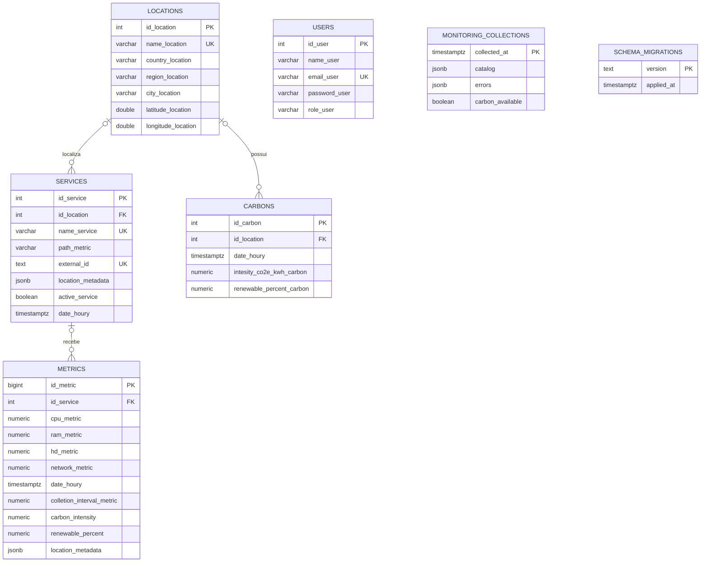

# 🗄️ Camada de persistência — PostgreSQL

O [DDL](DDL.sql) define a instalação nova. [DML.sql](DML.sql) provisiona contas iniciais por ambiente e armazena hashes bcrypt via `pgcrypto`. [migrations](migrations/) adaptam bancos já inicializados. Os [repositories](../backend/src/modules/) executam DML parametrizado via driver `pg`, sem ORM.

## MER e DER

Conceitualmente, uma localização pode hospedar serviços e possuir fatores regionais. Um serviço recebe leituras. Conta e rodada são entidades independentes. Os [diagramas iniciais](../docs/Modelo%20MER%20e%20DER/) registram o desenho histórico. O DER abaixo representa os relacionamentos físicos atuais, com FKs opcionais e sem relacionamento relacional para o catálogo JSON de uma rodada.



| Estrutura | Restrições e índices relevantes |
|---|---|
| `users` | E-mail único. Perfil `USER` por padrão e domínio `USER` ou `ADMIN`. |
| `locations` | Nome único, latitude e longitude obrigatórias com limites geográficos. Serviços sem coordenadas podem ficar sem FK e manter metadados JSON. |
| `services` | Nome único e índice único em `external_id`, que admite nulo. |
| `metrics` | CPU de 0 a 100, memória, disco e rede não negativos. Unicidade `(id_service, date_houry)`; índice de consulta por `(date_houry, id_service)`. Intensidade, percentual renovável e metadados podem ser nulos. |
| `carbons` | Intensidade não negativa e percentual de 0 a 100. Par `(id_location, date_houry)` único. |
| `monitoring_collections` | Uma rodada por instante, com catálogo, erros e disponibilidade de fatores. |
| `schema_migrations` | Controle do [executor de migrations](../backend/src/db/migrate.ts) por versão e data de aplicação. |

## Instalação, evolução e persistência

Inicie o serviço `postgres` pelo [Compose da raiz](../compose.yaml), com as credenciais e as seis variáveis das contas iniciais configuradas no [modelo de ambiente](../.env.example). Use e-mails distintos e senhas próprias entre 8 e 72 bytes para a carga inicial. O entrypoint executa o DDL e o DML em um volume vazio. Alterações das variáveis de seed após a inicialização não atualizam contas existentes. A senha do PostgreSQL é independente da senha da aplicação.

Em volumes existentes, o backend aplica `001_persisted_monitoring` (estrutura de histórico, índices e datas legadas assumidas em UTC), `002_recover_legacy_carbon` (recupera fatores regionais contemporâneos ou anteriores para registros elegíveis) e `003_user_roles` (perfis), nessa ordem. O executor usa transação, trava de migração e tabela de controle. Se a preparação falhar, o HTTP não inicia. Consulte [histórico](../backend/docs/HISTORY.md).

A [persistência de rodadas](../backend/src/modules/Monitoring/collection.repository.ts) grava catálogo, localizações, fatores, métricas e erros em uma transação. O [repositório de leitura](../backend/src/modules/Monitoring/monitoring.repository.ts) reconstrói o snapshot e as janelas históricas. O volume `postgres_data` monta `/var/lib/postgresql/data`. O serviço no Compose se chama `postgres`, e a porta publicada é 5433 na configuração de exemplo.

Para diagnosticar e verificar persistência em ambiente de homologação, rode o comando abaixo antes e depois de `docker compose restart postgres`, mantendo o mesmo projeto Compose. Compare os instantes das rodadas anteriores ao reinício e depois verifique se novas rodadas aparecem.

```bash
docker compose exec postgres sh -c 'psql -U "$POSTGRES_USER" -d "$POSTGRES_DB" -c "SELECT collected_at, carbon_available FROM monitoring_collections ORDER BY collected_at DESC LIMIT 5"'
```

Use o [runbook](../docs/troubleshooting.md) para exportar um backup e validar a recuperação em um banco separado. A opção `docker compose down --volumes` apaga o volume do projeto e seu histórico.
