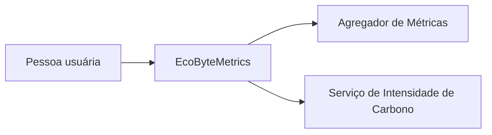
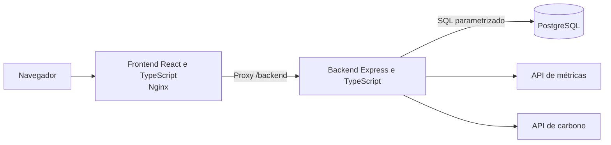
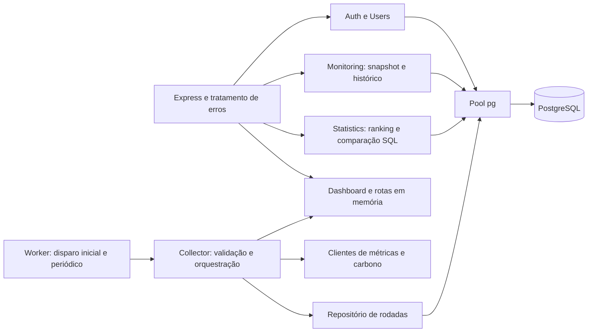
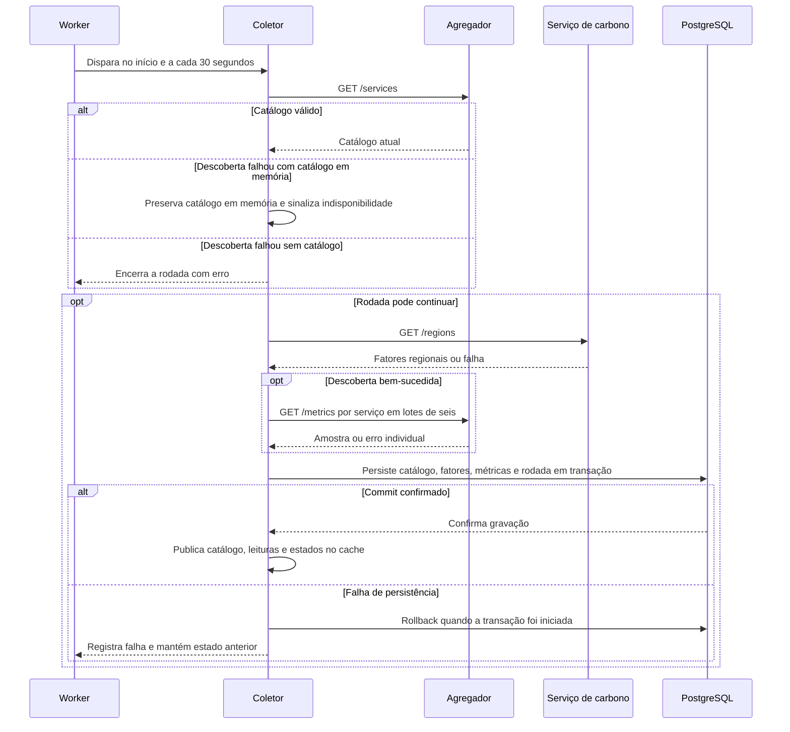
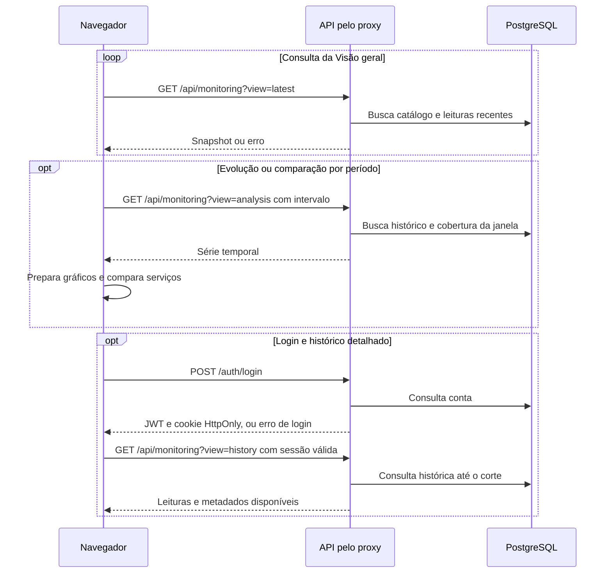

# Arquitetura e fluxos de dados — EcoByteMetrics

## Contexto C4

O EcoByteMetrics estima energia e emissões a partir de métricas operacionais e fatores regionais. As APIs auxiliares são serviços externos. O backend preserva leituras gravadas quando uma coleta posterior falha.

## Containers C4

O [Compose](../compose.yaml) executa frontend, backend e PostgreSQL. O navegador acessa a API por meio do proxy. A aplicação usa SQL parametrizado no PostgreSQL, sem ORM.

## Componentes

[server.ts](../backend/src/server.ts) prepara o banco antes de iniciar o HTTP. [app.ts](../backend/src/app.ts) registra as rotas e o tratador de exceções. A [API](api.md) distingue o monitoramento persistido das rotas de diagnóstico e cache.

## Descoberta, coleta, carbono e persistência

O [agendador](../backend/src/modules/Worker/worker.job.ts) ignora ciclos sobrepostos no mesmo processo. O [coletor](../backend/src/modules/Monitoring/collector.ts) valida a amostra e registra falhas por serviço. A [persistência](../backend/src/modules/Monitoring/collection.repository.ts) associa a intensidade pelo código regional. Quando falta fator, a energia continua disponível e a emissão tem cobertura incompleta.

## Snapshot, histórico, comparação e autenticação

A comparação pela última coleta reutiliza o snapshot resumido. O endpoint de comparação SQL atende consumidores da API e tem janela própria. O [adaptador do frontend](../frontend/src/features/monitoring/api/monitoring.ts) valida as respostas. Em falha HTTP, o [provider](../frontend/src/features/monitoring/providers/MonitoringProvider.tsx) pode preservar o snapshot anterior com indicação de indisponibilidade. A Administração usa consulta de configurações e operações da conta autenticada. O [router de autenticação](../backend/src/modules/Auth/auth.router.ts) restaura a sessão pelo cookie, e o [repositório de monitoramento](../backend/src/modules/Monitoring/monitoring.repository.ts) lê o histórico persistido.

## Referências

- [README principal](../README.md)
- [API de Métricas](https://metrics.unilaunch.org/docs)
- [API de Intensidade de Carbono](https://carbon.unilaunch.org/docs)
