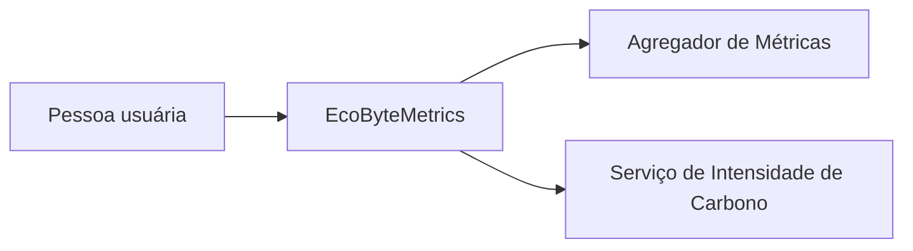
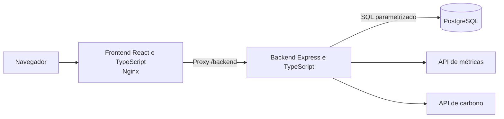
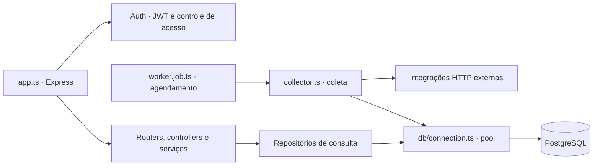
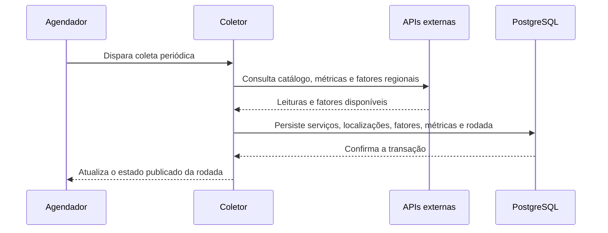
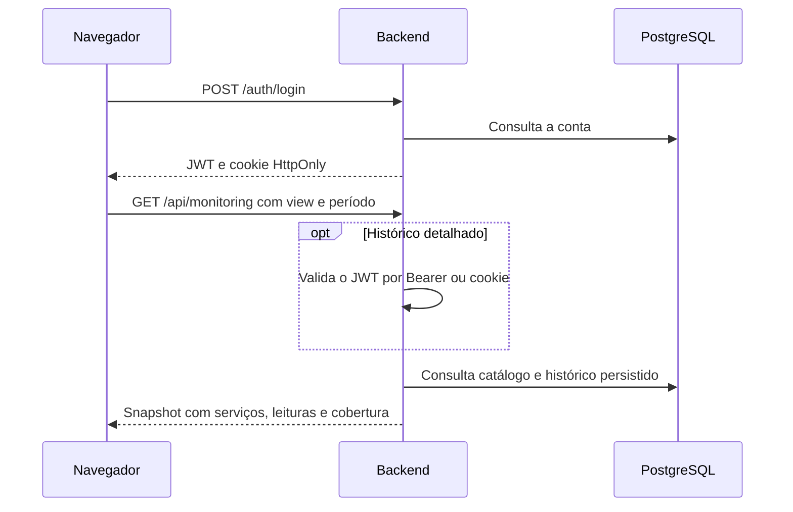

# Arquitetura e fluxos de dados — EcoByteMetrics

## Contexto C4

O EcoByteMetrics estima energia e emissões a partir de métricas operacionais e fatores regionais. As APIs auxiliares são serviços externos. O backend preserva leituras gravadas quando uma coleta posterior falha.

## Containers C4

O [Compose](../compose.yaml) executa frontend, backend e PostgreSQL. O navegador acessa a API por meio do proxy. A aplicação usa SQL parametrizado no PostgreSQL, sem ORM.

## Arquitetura lógica do backend

[server.ts](../backend/src/server.ts) executa as migrations antes de iniciar o servidor e o agendamento. [worker.job.ts](../backend/src/modules/Worker/worker.job.ts) evita rodadas concorrentes, e [collector.ts](../backend/src/modules/Monitoring/collector.ts) integra as fontes externas e persiste a rodada. O catálogo em memória atende as rotas de últimas leituras. As consultas analíticas usam dados persistidos.

## Coleta e persistência

A rodada registra o catálogo e as falhas de coleta em `monitoring_collections`. A leitura guarda a intensidade disponível naquele momento. Leituras sem fator têm cobertura de emissões incompleta. O [DDL](../database/DDL.sql) estrutura a instalação nova, e as [migrations](../database/migrations/) adaptam bancos anteriores antes do uso.

## Consulta do dashboard e sessão

A Visão geral usa `view=latest`. Evolução e Comparar usam `view=analysis`. O histórico detalhado exige autenticação. O adaptador [monitoring.ts](../frontend/src/features/monitoring/api/monitoring.ts) valida e normaliza o snapshot. A Administração consulta as configurações da coleta em modo somente leitura e usa as rotas de conta autenticadas. As permissões e os parâmetros estão na [documentação da API](api.md).

## Referências

- [README principal](../README.md)
- [API de Métricas](https://metrics.unilaunch.org/docs)
- [API de Intensidade de Carbono](https://carbon.unilaunch.org/docs)
