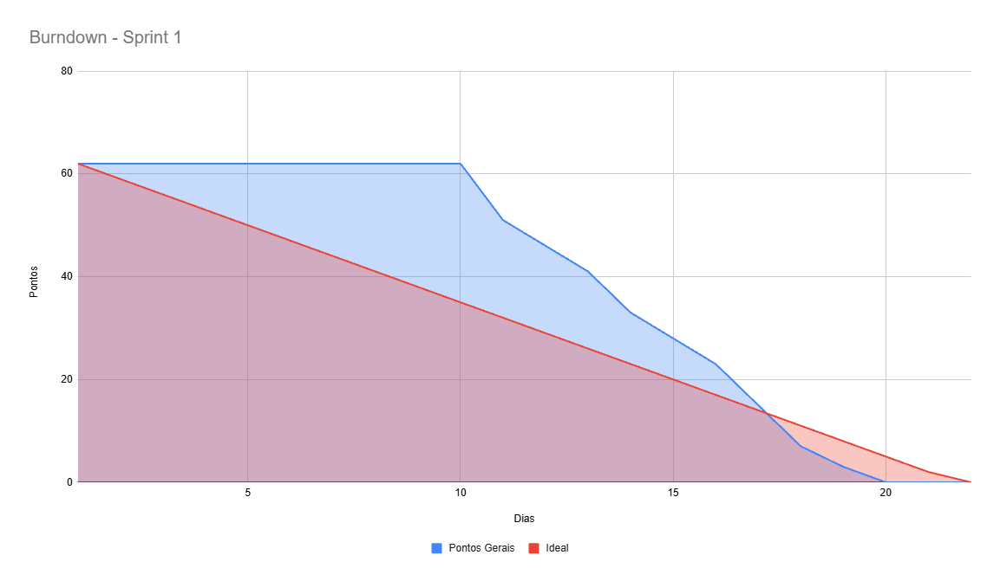

# 📄 Sprint Review — Sprint 1

## Projeto: EcoByteMetrics (GreenER) | Período: 28/09/2026 a 19/10/2026

## 🎥 1. Demonstração em Vídeo & Evidências Principais

<table>
  <tr>
    <td width="50%" align="center" valign="middle">
      <!-- target="_blank" garante a abertura em nova guia no navegador -->
      
    </td>
    <td width="60%" valign="top">
      <h4>🎬 Demonstração Prática — Sprint Review 1</h4>
      
Neste vídeo, a equipe apresenta o incremento funcional desenvolvido durante a primeira Sprint do <b>EcoByteMetrics (GreenER)</b>:

      <ul>
        <li><b>Orquestração Docker:</b> Subida unificada do ambiente containerizado (Frontend, Backend e PostgreSQL).</li>
        <li><b>Persistência Nativa:</b> Execução dos scripts <code>database/ddl.sql</code> diretamente no PostgreSQL sem o uso de ORM.</li>
      </ul>
    </td>
  </tr>
</table>

---

## 🎯 2. Objetivo da Sprint

**Estabelecer a fundação técnica e documental do projeto**, contemplando a orquestração em Docker Compose, a modelagem DDL no PostgreSQL sem ORM, a prototipagem e interface responsiva em React + TS com suporte à localização, e a estruturação do backend em Node.js + TS com rotina de polling para descoberta e coleta de métricas.

---

## 📊 3. Resumo de Entregas (US00, US01, US02)

| User Story | Sub-issues Concluídas | Requisitos Cobertos |
| :--- | :--- | :--- |
| **US00 (#2)** — Setup Infra & Schema SQL | `#12`, `#13`, `#14`, `#15`, `#16`, `#43`, `#44`, `#47` | RNF05, RP02, RP03, RP04 |
| **US01 (#3)** — UI Responsiva & Localização | `#17`, `#49`, `#52` | RF11, RF12, RNF01, RP01 |
| **US02 (#4)** — Polling & Descoberta Dinâmica | `#20`, `#21`, `#22`, `#23` | RF01, RF02, RF03 |

<b>🔍 Clique aqui para expandir a lista simplificada de tarefas entregues</b>

* **US00 — Documentação e Infraestrutura (#2):** Prototipagem Figma (`#16`), Diagramas C4/Mermaid (`#43`), MER (`#44`), Script DDL Nativo (`#12`), Container PostgreSQL (`#13`), Docker Compose (`#14`), Documentação REST (`#47`) e README (`#15`).
* **US01 — Interface e Localização (#3):** Componentes React+TS (`#17`), Exibição de Cidade (`#49`) e Timestamp da Última Atualização (`#52`).
* **US02 — Backend e Polling (#4):** Servidor Node.js Modular (`#20`), Consumo de `/services` (`#21`), Polling Periódico (`#22`) e Coleta `/metrics/{id}` (`#23`).

---

## 📈 3.1. Gráfico de Burndown da Sprint 1

  
  
<i>Acompanhamento da evolução diária dos 62 Story Points planejados e entregues na Sprint 1.</i>

> **📌 Observação:**  
> A redução dos pontos iniciou-se no 11º dia de sprint (08/10), período dedicado ao alinhamento da equipe, definição de papéis e organização das ferramentas de trabalho. Com essa base consolidada, a Sprint 2 terá previsão e fluidez na execução das entregas.

---

## 📝 4. Avaliação Geral da Sprint 1 & Pontos de Atenção para a Sprint 2

* **O que funcionou bem:** A boa comunicação da equipe e o uso do GitHub para versionamento e acompanhamento do projeto.
* **O que precisa melhorar / Pontos de atenção para a Sprint 2:** A divisão de tarefas, realizando essa alocação de forma mais antecipada no início da próxima sprint e a separação de pontos para cada task.
