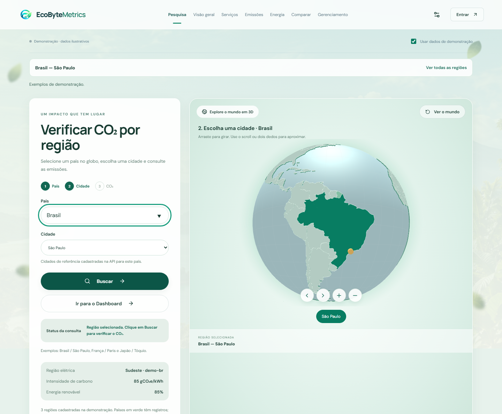
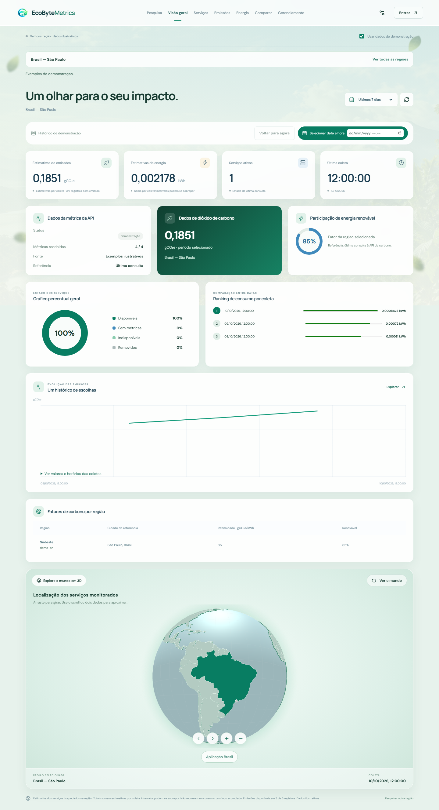
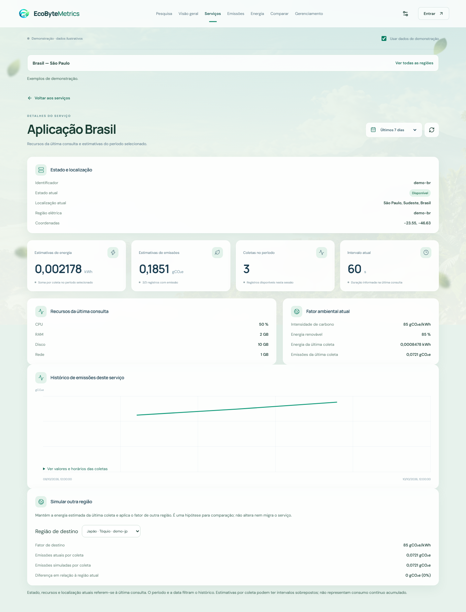

# Tour do EcoByteMetrics

Abra http://localhost:5173 com o frontend e o backend local em execução. Esta versão muda somente frontend/. As páginas consultam serviços e mostram estimativas; o navegador não controla os serviços monitorados.

## Comece por uma visita reproduzível

1. Abra /login e clique em **Entrar em modo demonstração**. Não precisa preencher uma conta.
2. Em **Pesquisa**, selecione **Brasil** e **São Paulo**, depois clique em **Buscar**.
3. No dashboard, confira os indicadores, as três coletas ilustrativas, os fatores regionais e o mapa.
4. Troque para **Últimas 24 horas**: ficará a coleta mais recente do exemplo. Selecione **08/10/2026, 23:59**: a janela será as 24 horas anteriores a essa data, recuperando a coleta daquele dia.
5. Visite **Emissões** e **Energia**. A região, o período e a data seguem na URL e no aviso acima da página.
6. Em **Serviços**, clique em **Aplicação Brasil** para abrir seus detalhes.
7. Nos detalhes, selecione uma **Região de destino** para testar outra intensidade de carbono. Os fatores desta demonstração são ilustrativos e iguais; use dados reais para explorar fatores diferentes.
8. Clique em **Ver todas as regiões**, abra **Comparar** e adicione duas aplicações. O exemplo tem somente um serviço com energia válida: a ausência de coletas em comum é esperada. Com dois serviços reais válidos, aparecem as taxas comparáveis.
9. Volte à Pesquisa e teste **França / Paris** e **Japão / Tóquio** para conhecer indisponibilidade e métricas incompletas.
10. Desmarque **Usar dados de demonstração** para consultar as APIs reais. A seleção é revalidada; a disponibilidade muda durante o desafio.

A demonstração não gera requisições, contas ou alterações no servidor. Ela termina ao recarregar a aplicação. Suas datas são fixas para permitir repetir esta apresentação.

## Controles compartilhados

**Navegação:** no computador, fica no cabeçalho; no celular, em Abrir navegação. Há entradas para pesquisa, visão geral, serviços, emissões, energia, comparação e gerenciamento. A engrenagem abre preferências. Entrar abre a prévia de autenticação. A marca volta à apresentação.

**Contexto da análise:** a faixa acima das páginas informa a região escolhida ou Todas as regiões. Ver todas as regiões remove país, cidade e código regional; mantém período e data. Navegar pelas telas de análise preserva esses filtros. Uma URL pode ser compartilhada, mas o histórico real depende das coletas existentes em cada sessão.

**Período:** 24 horas, 7 dias ou 30 dias. Filtra os registros já coletados e não busca um histórico no banco. Quando há uma data final selecionada, a janela termina nessa data; caso contrário, termina na última consulta válida.

**Atualizar indicadores:** solicita nova descoberta, catálogo de carbono e métricas. Fica desabilitado enquanto existe uma consulta pendente. Atualizar um período não dispara outra coleta.

**Atualização automática:** a cada 30 segundos nas páginas de monitoramento, incluindo detalhes de serviço. Abas ocultas pausam as consultas. Preferências, apresentação, login e prévia administrativa não iniciam polling.

**Dados reais / demonstração:** o checkbox troca a fonte explicitamente. A troca remove identificadores regionais, data e serviços da comparação que poderiam pertencer à fonte anterior. País e cidade podem permanecer para uma nova busca.

**Estados de conexão:** a faixa mostra consulta em andamento, última consulta válida ou dados antigos após falha. Dados ausentes aparecem como —; zero é uma medida válida. Avisos explicam cobertura parcial e fatores indisponíveis.

## Apresentação — /

Explica o projeto, os recursos computacionais e a relação entre potência, energia e CO₂e. O exemplo de 60 segundos vem do modelo do desafio: aproximadamente 0,000848 kWh e 0,072 gCO₂e.

Explorar dashboard abre a visão geral. Pesquisa abre o fluxo por região. Os links internos levam às seções da apresentação. Pausar paisagens interrompe o carrossel; Retomar paisagens reativa. A preferência do dispositivo por movimento reduzido é respeitada.

## Pesquisa — /pesquisa

É o caminho para descobrir o impacto de uma localização.

- **País:** digite ou selecione no globo. A lista sugere países presentes no catálogo de carbono.
- **Cidade:** escolha uma referência regional cadastrada. Quando duas regiões possuem a mesma cidade, o código distingue as opções. Não representa qualquer município do mundo.
- **Globo:** arraste para girar, use scroll ou dois dedos para aproximar, clique no país e depois no marcador ou no botão da cidade.
- **Ver o mundo:** limpa a seleção geográfica.
- **Atualizar regiões:** consulta novamente o catálogo e os serviços.
- **Buscar:** atualiza os dados, verifica a região e seus serviços e abre o dashboard quando há dados completos.
- **Ir para o Dashboard:** permite inspecionar a seleção diretamente, incluindo estados parciais.

Abaixo do formulário aparecem código da região elétrica, intensidade de carbono e participação renovável.

Existem respostas distintas:

| Situação | O que a interface faz |
|---|---|
| País/cidade ainda não selecionados | Solicita completar a seleção |
| Região não cadastrada | Mostra Região desconhecida e oferece Nova busca |
| Região cadastrada sem serviços atuais | Informa que não há serviços monitorados |
| Todos os serviços indisponíveis | Mostra Serviço indisponível e permite tentar novamente |
| Parte das métricas ou fatores ausente | Lista motivos e permite Ver dashboard com dados parciais |
| Falha de conexão ou catálogo | Exibe indisponibilidade sem transformar isso em erro 404 |
| Tudo disponível | Abre o dashboard regional |

Alterar a seleção ou sair da página invalida uma busca anterior. A resposta atrasada não muda a página escolhida pelo usuário. Se WebGL não funcionar, os campos de país e cidade continuam disponíveis.

## Visão geral — /dashboard

Reúne:

- **Estimativas de emissões e energia:** somas das observações válidas da janela selecionada, com cobertura informada.
- **Serviços ativos:** estado da última consulta, independentemente da data histórica.
- **Última coleta:** último registro encontrado no histórico filtrado.
- **Dados da métrica:** estado da consulta, quantidade de campos recebidos e fonte.
- **Participação renovável:** fator da região ou média simples das regiões monitoradas. Não significa energia exclusivamente solar.
- **Distribuição dos serviços:** disponíveis, sem métricas, indisponíveis e removidos.
- **Ranking por coleta:** horários com maiores somas de energia no período.
- **Histórico de emissões:** evolução e tabela acessível em Ver valores e horários das coletas.
- **Fatores de carbono:** código, cidade de referência, intensidade e renováveis.
- **Mapa:** coordenadas dos serviços. Clicar no marcador ou no nome abre seus detalhes.

Selecionar data e hora aplica um limite final ao histórico. Voltar para agora remove esse limite. Estado, recursos, localização e fatores atuais continuam sendo da última consulta. A interface avisa quando a URL contém uma data inválida.

Pesquisar outra região volta ao formulário mantendo a seleção para edição.

## Serviços — /servicos

A tabela mostra estado, localização, CPU, RAM, disco, rede, intensidade regional, intervalo, energia e CO₂e da última coleta.

Buscar serviço ou região filtra nomes e localizações. Filtrar por estado separa os quatro estados. Ordenar serviços usa nome, maior emissão ou maior energia da última coleta. Esses filtros ficam na URL e sobrevivem à ida aos detalhes e ao retorno pela lista.

Clique no nome para abrir um serviço. Falta de resultado na busca não equivale a falta de conexão; há mensagens específicas.

## Detalhes — /servicos/:id

Reúne identificador, estado, localização atual, região elétrica, coordenadas e motivo de erro, quando houver. Os cartões mostram somas históricas, número de coletas e intervalo atual. Recursos da última consulta e Fator ambiental atual deixam clara a diferença entre dados atuais e históricos.

O gráfico contém apenas as coletas daquele serviço dentro dos filtros. Voltar aos serviços recupera o contexto e os filtros da tabela.

**Simular outra região** mantém a energia da última coleta e calcula:

~~~text
CO₂e simulado = energia da última coleta × fator da região de destino
Diferença = CO₂e simulado − CO₂e atual
~~~

Exibe valor atual, valor simulado, diferença absoluta e percentual quando o valor atual é positivo. Sem energia válida não há simulação; sem emissão atual, a estimativa de destino ainda pode aparecer, mas a diferença permanece —.

A hipótese não considera diferenças de desempenho entre máquinas, preço, latência ou efeitos de uma migração real. Ela não envia operações de alteração para nenhuma API.

Serviço desconhecido apresenta um estado vazio com caminho de volta. Durante falha de conexão, a tela informa que não conseguiu confirmar o identificador.

## Emissões e energia — /emissoes e /energia

Cada página mostra soma das estimativas, serviços atuais da seleção e quantidade de registros no período. O gráfico acompanha a evolução. O ranking organiza os serviços com estimativas válidas naquela janela; coletas continuam associadas à localização registrada quando foram realizadas.

Os textos explicam as fórmulas. Quantidades e durações diferentes de observações influenciam as somas; o ranking não comprova eficiência por transação.

## Comparação — /comparar

Adicione de dois a quatro serviços. Remover ao lado do nome libera espaço. Os identificadores selecionados ficam na URL; IDs ausentes do catálogo atual não bloqueiam novas escolhas.

A primeira tabela usa somente ciclos com coleta para todos os serviços selecionados. Normaliza pela duração informada e mostra kWh/h, gCO₂e/h, quantidade de coletas, cobertura e soma dos intervalos.

A segunda tabela mostra CPU, RAM, disco e rede da última consulta, mesmo sem histórico em comum. Sem dados suficientes, a interface explica o motivo em vez de inventar números.

Para comparar regiões diferentes, use Ver todas as regiões antes de escolher serviços. Um filtro regional limita as opções àquela seleção.

## Preferências — /configuracoes

Folhas em movimento controla o efeito decorativo. Período padrão define a janela inicial. Salvar preferências aplica e grava no navegador; Descartar alterações recupera o valor salvo. O formulário indica mudanças ainda não salvas e desabilita Salvar quando nada mudou.

São preferências locais, não configurações de monitoramento do servidor. A política de movimento reduzido do dispositivo sempre prevalece. Se o navegador bloquear armazenamento, a mudança continua na sessão e a mensagem explica a limitação.

## Login e cadastro — /login e /cadastro

São prévias. Os campos e o envio permanecem desabilitados porque não existe contrato de autenticação no backend atual.

Consultar sem conta abre a pesquisa com a fonte atualmente selecionada. Entrar em modo demonstração ativa explicitamente os exemplos e abre a pesquisa. Nenhuma senha é enviada ou armazenada.

Não há proteção real por perfil nem sessão autenticada. A prévia não comprova segurança administrativa.

## Gerenciamento — /gerenciamento

**Usuários:** no modo real, informa a integração pendente. No modo demonstração, permite buscar usuários de exemplo, filtrar estado, editar perfil, bloquear e desbloquear. As mudanças valem somente durante aquela visita.

**Sistema:** mostra o modo, a quantidade de serviços já observados e a ausência de autenticação.

**Requisições da API:** lista até 50 requisições reais desta sessão, com URL, HTTP ou falha, duração até a resposta e horário. Consultar agora faz uma consulta de monitoramento, sem operações de alteração. Limpar registros locais remove somente essa lista em memória. Não é auditoria do servidor.

**Configurações:** abre as preferências locais. Ir para pesquisa volta ao fluxo público.

## Página desconhecida

Uma rota inexistente abre a página 404. Voltar ao início abre a apresentação. Voltar à página anterior usa o histórico interno; em um acesso direto sem esse histórico, abre a pesquisa. Erros de API não são tratados como páginas inexistentes.

## Como interpretar os números

O modelo simplificado do desafio usa CPU máxima de 100 W, memória de 0,375 W/GB, disco de 0,01 W/GB e rede de 0,02 W/GB. Energia usa o intervalo informado pela API; CO₂e multiplica essa energia pelo fator regional.

As consultas podem observar intervalos sobrepostos. Somar estimativas não prova consumo contínuo acumulado. Emissões parciais não representam todos os serviços. Comparação normalizada não prova eficiência por requisição.

O histórico real fica em memória, limitado aos registros da sessão e a 30 dias de retenção. Recarregar elimina as coletas. Autenticação, histórico persistente e administração real continuam dependendo do trabalho do backend.
